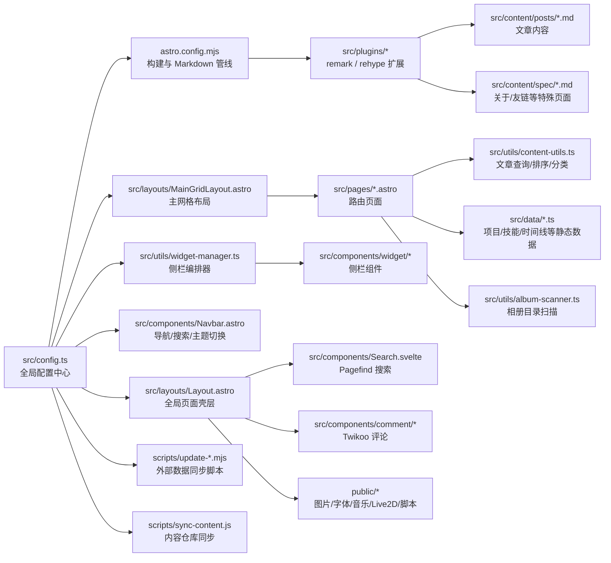
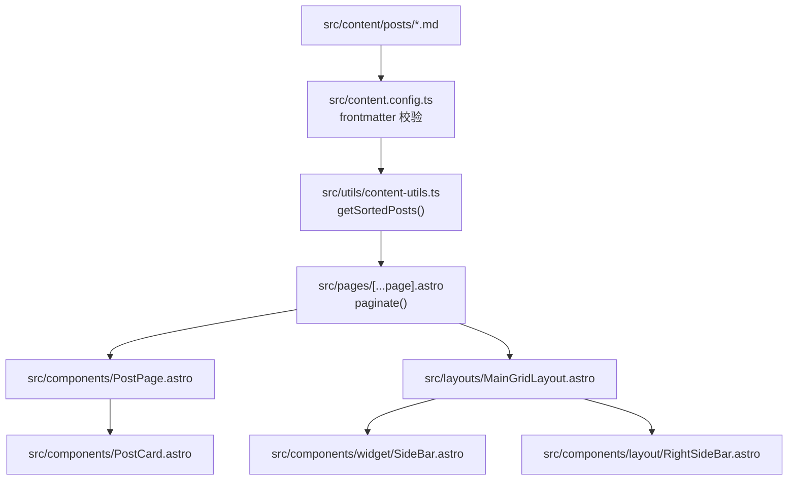
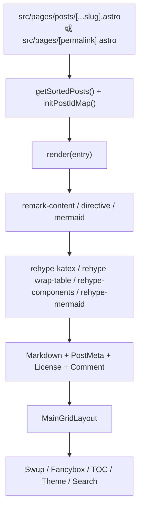
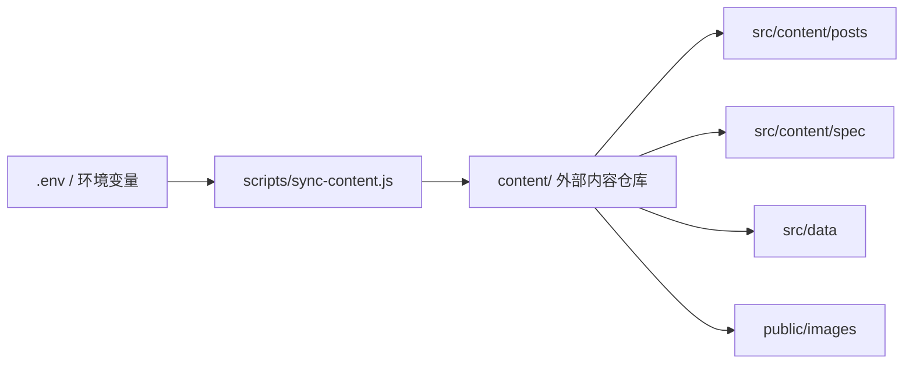

# Mizuki 项目结构分析与自定义开发指南

本文基于当前仓库代码结构整理，目标是帮助你快速回答 3 个问题：

1. 这个项目是怎么组织的。
2. 一次页面渲染或数据更新会经过哪些模块。
3. 我应该改哪些文件，才能安全地做二次开发。

项目本质上是一个以 Astro 为核心、Svelte 负责部分交互组件、TypeScript 负责配置与数据建模、Markdown 负责内容承载的静态博客/个人站点系统。它同时内置了内容仓库分离、追番数据同步、相册扫描、评论、搜索、主题切换、侧栏组件编排等扩展能力。

## 1. 项目根目录结构说明

### 1.1 根目录总览

```text
.
├─ .devin/                     # 辅助配置目录
├─ .github/                    # GitHub Actions / 仓库协作配置
├─ .vscode/                    # VS Code 工作区配置
├─ docs/                       # 项目文档
├─ public/                     # 静态资源，构建时原样输出
├─ scripts/                    # Node 脚本：内容同步、数据抓取、构建辅助
├─ src/                        # 应用源码
├─ .env.example                # 环境变量示例
├─ astro.config.mjs            # Astro 构建配置与 Markdown 插件链
├─ package.json                # 依赖与脚本入口
├─ pagefind.yml                # Pagefind 搜索配置
├─ pnpm-workspace.yaml         # pnpm workspace 配置
├─ postcss.config.mjs          # PostCSS 配置
├─ svelte.config.js            # Svelte 集成配置
├─ tsconfig.json               # TypeScript 配置
└─ vercel.json                 # Vercel 部署配置
```

### 1.2 主要目录与职责

| 路径 | 作用 | 典型内容 | 自定义建议 |
| --- | --- | --- | --- |
| `src/pages/` | Astro 路由入口层 | 首页、文章页、特色页、RSS/API 路由 | 新增页面优先改这里 |
| `src/layouts/` | 页面骨架层 | 全局 `Layout`、网格 `MainGridLayout` | 改整体布局从这里入手 |
| `src/components/` | 可复用 UI 组件层 | 导航、文章卡片、评论、侧栏组件、Svelte 交互组件 | 改样式和交互的主战场 |
| `src/utils/` | 通用逻辑层 | 内容排序、URL 生成、侧栏管理、主题设置 | 改规则逻辑从这里入手 |
| `src/data/` | 强类型静态数据层 | 项目、技能、时间线、友链、设备、日记、追番本地数据 | 特色页面配置入口 |
| `src/content/` | 内容层 | `posts/` 博客文章、`spec/` 特殊页面 Markdown | 改文章和单页内容优先改这里 |
| `src/plugins/` | Markdown/HTML 扩展层 | remark / rehype 插件、自定义指令、Mermaid 支持 | 改内容语法和渲染规则从这里入手 |
| `src/styles/` | 样式层 | 全局样式、组件样式、页面补丁样式 | 改主题与视觉表现 |
| `public/` | 原样分发静态资源 | 图片、音乐、Live2D、字体、JS | 放置无需打包处理的资源 |
| `scripts/` | 构建前后与数据同步脚本 | `sync-content.js`、`update-*.mjs`、`new-post.js` | 改数据抓取与自动化流程 |
| `docs/` | 项目文档 | 部署、内容分离、迁移说明 | 适合沉淀二开规范 |

### 1.3 `src/` 内部结构建议理解顺序

```text
src/
├─ pages/                      # 路由
├─ layouts/                    # 页面框架
├─ components/                 # 组件
├─ utils/                      # 通用工具
├─ data/                       # 特色页数据
├─ content/                    # Markdown 内容
├─ plugins/                    # Markdown/rehype 扩展
├─ styles/                     # 样式
├─ i18n/                       # 多语言字典
├─ constants/                  # 常量
├─ types/                      # 类型定义
└─ config.ts                   # 全局配置中心
```

建议按这个顺序读代码：`src/config.ts` -> `astro.config.mjs` -> `src/layouts/` -> `src/pages/` -> `src/utils/` -> `src/components/` -> `src/data/`。

## 2. 核心模块划分与依赖关系

### 2.1 模块架构图



### 2.2 核心模块分层

| 模块 | 关键文件 | 主要职责 | 上游依赖 | 下游输出 |
| --- | --- | --- | --- | --- |
| 配置层 | `src/config.ts`, `src/types/config.ts` | 统一站点配置、组件开关、外部服务参数 | 无 | 被构建层、页面层、组件层、脚本层消费 |
| 构建层 | `astro.config.mjs`, `src/content.config.ts` | 配置 Astro、内容集合校验、Markdown 插件链、静态输出策略 | 配置层、插件层 | 生成构建规则与内容 schema |
| 路由层 | `src/pages/*.astro` | 每个 URL 的页面入口、静态路径生成、页面装配 | 布局层、工具层、内容层、数据层 | HTML 页面、RSS/API 路由 |
| 布局层 | `src/layouts/Layout.astro`, `src/layouts/MainGridLayout.astro` | 全局 `<head>`、主题初始化、Banner、网格布局、侧栏与 TOC 容器 | 配置层、组件层、工具层 | 页面骨架 |
| 组件层 | `src/components/*` | 具体 UI 与交互实现 | 配置层、工具层、数据层 | 页面局部视图 |
| 工具层 | `src/utils/*` | URL、内容排序、布局管理、主题设置、相册扫描 | 配置层 | 为页面/组件提供逻辑能力 |
| 数据层 | `src/data/*`, `src/content/*` | Markdown 内容与结构化静态数据 | 内容同步脚本、手工维护 | 页面渲染数据源 |
| 自动化脚本层 | `scripts/*` | 同步内容、抓取追番数据、创建新文章、压缩字体 | 配置层、环境变量 | 更新 `src/data` / `src/content` / `public` |

### 2.3 关键依赖关系说明

1. `src/config.ts` 是项目真正的“控制台”，页面、组件、脚本几乎都直接读取它。
2. `astro.config.mjs` 定义了 Markdown 到页面内容的加工链，直接决定文章支持哪些语法和组件。
3. `src/layouts/Layout.astro` 负责全局 JS 初始化，包含主题、搜索、Swup、分析脚本、Fancybox、Katex、Panel 管理等高耦合逻辑。
4. `src/layouts/MainGridLayout.astro` 负责 Banner、主内容网格、左/右侧栏、浮动 TOC、壁纸模式等页面级布局编排。
5. `src/utils/widget-manager.ts` 是侧栏系统的枢纽，负责根据设备类型和位置返回需要渲染的组件。
6. `src/pages/posts/[...slug].astro` 与 `src/pages/[permalink].astro` 共同承担文章详情页，分别处理默认文章路由和根路径 permalink。

## 3. 配置文件说明

### 3.1 核心配置文件一览

| 文件 | 作用 | 关键配置项 | 自定义方法 |
| --- | --- | --- | --- |
| `package.json` | 依赖与脚本入口 | `dev`, `build`, `sync-content`, `update-anime`, `new-post` | 通过脚本扩展构建流程 |
| `astro.config.mjs` | Astro 构建配置 | `integrations`, `markdown.remarkPlugins`, `markdown.rehypePlugins`, `site`, `vite` | 扩展内容语法、SEO、构建行为 |
| `src/config.ts` | 全局运行配置 | `siteConfig`, `navBarConfig`, `sidebarLayoutConfig`, `commentConfig` 等 | 高频修改入口 |
| `src/types/config.ts` | 配置类型定义 | `SiteConfig`, `SidebarLayoutConfig`, `WidgetComponentType` | 扩展配置结构时同步修改 |
| `src/content.config.ts` | 内容集合定义 | `posts`, `spec` schema | 增加 frontmatter 字段或新增 collection |
| `.env.example` | 环境变量模板 | `ENABLE_CONTENT_SYNC`, `CONTENT_REPO_URL`, `INDEXNOW_*`, `BILI_SESSDATA` | 复制为 `.env` 后填值 |
| `pagefind.yml` | 搜索索引配置 | Pagefind 行为 | 改搜索索引策略 |
| `tsconfig.json` | TypeScript 编译配置 | 路径别名、类型检查 | 二开时新增别名或严格度调整 |
| `svelte.config.js` | Svelte 集成配置 | 预处理器 | Svelte 组件改造时使用 |
| `vercel.json` | 平台部署配置 | Header/路由行为 | 针对 Vercel 部署优化 |

### 3.2 `src/config.ts` 的配置块拆解

| 配置块 | 作用 | 常见自定义 |
| --- | --- | --- |
| `siteConfig` | 全站元信息与功能总开关 | 标题、副标题、语言、时区、站点 URL、主题色 |
| `siteConfig.featurePages` | 特色页面启停 | 关闭未使用页面并从导航中移除 |
| `siteConfig.banner` | 顶部 Banner 与首页文字 | 背景图、轮播、波浪、首页打字机文案、图片 API |
| `siteConfig.wallpaperMode` | Banner / 全屏壁纸 / 无壁纸模式 | 默认布局模式与移动端切换按钮显示策略 |
| `siteConfig.postListLayout` | 首页文章列表布局 | 列表 / 网格、是否允许切换 |
| `siteConfig.toc` | 文章目录 | 侧栏目录或浮动目录、层级深度 |
| `siteConfig.font` | 字体策略 | ASCII/CJK 字体、字体压缩 |
| `siteConfig.bangumi` / `siteConfig.bilibili` / `siteConfig.anime` | 追番页数据源配置 | 用户 ID、开发环境抓取策略、封面镜像 |
| `navBarConfig` | 顶部导航 | 菜单项、层级菜单、外链/内链 |
| `profileConfig` | 头像、昵称、简介、社交链接 | 改个人资料和社交入口 |
| `commentConfig` | 评论系统 | Twikoo 开关和 `envId` |
| `musicPlayerConfig` | 音乐播放器 | 本地 / Meting 模式、歌单 ID |
| `sidebarLayoutConfig` | 左右侧栏和移动抽屉布局 | 组件位置、顺序、折叠阈值、断点 |
| `pioConfig` | Live2D 看板娘 | 模型路径、位置、对话文案 |

### 3.3 环境变量说明

| 变量 | 用途 | 不配置时行为 |
| --- | --- | --- |
| `ENABLE_CONTENT_SYNC` | 是否启用内容仓库同步 | `false` 时直接使用仓库内本地内容 |
| `CONTENT_REPO_URL` | 外部内容仓库地址 | 不填则不克隆远端内容仓库 |
| `CONTENT_DIR` | 外部内容仓库落地目录 | 默认 `./content` |
| `INDEXNOW_KEY` | IndexNow 主动提交 key | 不影响站点正常运行 |
| `INDEXNOW_HOST` | IndexNow 站点域名 | 不影响站点正常运行 |
| `BILI_SESSDATA` | Bilibili 观看进度抓取凭证 | 无法抓取更完整观看进度 |

### 3.4 开发与生产差异

1. `predev` 和 `prebuild` 都会先执行 `scripts/sync-content.js`，因此即使本地开发也会尝试同步内容。
2. 搜索依赖 Pagefind，`src/components/Search.svelte` 在开发环境会显示假数据，只有 `build + preview` 才能验证真实搜索。
3. 追番页在 `fetchOnDev = false` 时，开发环境不会读取外部抓取结果 JSON。
4. 评论系统通过前端脚本初始化，Swup 页面切换后会重新挂载 Twikoo。

## 4. 主要业务流程说明

### 4.1 文章列表与首页分页流程



流程要点：

1. 文章源文件位于 `src/content/posts/`，先由 `src/content.config.ts` 校验 frontmatter。
2. `getSortedPosts()` 过滤草稿、执行置顶排序、补充上一篇/下一篇信息。
3. `src/pages/[...page].astro` 使用 Astro 的 `paginate()` 生成首页及分页页。
4. `src/components/PostPage.astro` 负责文章卡片列表容器和列表/网格切换联动。
5. `MainGridLayout` 决定左右侧栏、Banner、目录、壁纸模式。

### 4.2 文章详情渲染流程



流程要点：

1. 详情路由分成两套：
   - `src/pages/posts/[...slug].astro`：默认文章路径与兼容别名路径。
   - `src/pages/[permalink].astro`：根路径 permalink 与自定义 permalink。
2. `src/utils/permalink-utils.ts` 负责 `%year%`、`%post_id%`、`%postname%` 等规则替换。
3. `render(entry)` 返回正文内容和 `headings`，再交给 `Markdown.astro` 和 TOC 组件消费。
4. `src/plugins/remark-content.mjs` 会计算摘要、字数和阅读时间，并注入 frontmatter。
5. 若文章启用加密，会走 `PasswordProtection.astro` 或 `Encryptor.astro` 分支。
6. 评论由 `src/components/comment/index.astro` 决定是否启用，Twikoo 真正挂载在 `src/components/comment/Twikoo.astro`。

### 4.3 特色页面数据流

| 页面 | 数据来源 | 主入口文件 | 特点 |
| --- | --- | --- | --- |
| 关于页 | `src/content/spec/about.md` | `src/pages/about.astro` | Markdown 单页渲染 |
| 友链页 | `src/content/spec/friends.md` + `src/data/friends.ts` | `src/pages/friends.astro` | 文案与卡片数据分离 |
| 日记页 | `src/data/diary.ts` | `src/pages/diary.astro` | 时间差格式化、图片灯箱 |
| 项目页 | `src/data/projects.ts` | `src/pages/projects.astro` | 分类、精选、技术栈统计 |
| 技能页 | `src/data/skills.ts` | `src/pages/skills.astro` | 技能图表 + 卡片 |
| 时间线 | `src/data/timeline.ts` | `src/pages/timeline.astro` | 分类统计 + 时间序列展示 |
| 设备页 | `src/data/devices.ts` | `src/pages/devices.astro` | 按品牌筛选 |
| 相册列表/详情 | `public/images/albums/*` + `info.json` | `src/pages/albums.astro`, `src/pages/albums/[id]/index.astro` | 构建时扫描目录并生成路由 |
| 追番页 | `src/data/anime.ts` 或 `src/data/*.json` | `src/pages/anime.astro` | 本地/ Bangumi / Bilibili 三种模式 |

### 4.4 相册流程

1. `src/utils/album-scanner.ts` 在构建时扫描 `public/images/albums/*`。
2. 每个相册目录至少需要 `info.json`，本地模式还需要 `cover.jpg`。
3. 扫描结果被 `src/pages/albums.astro` 用于相册列表，被 `src/pages/albums/[id]/index.astro` 用于详情页静态路径生成。
4. 若 `info.json` 中设置 `mode: "external"`，则图片和封面可以来自外部 URL。
5. 若设置 `hidden: true`，则相册不会出现在页面中。

### 4.5 内容仓库同步流程



流程要点：

1. `scripts/sync-content.js` 读取 `.env`。
2. 如果 `ENABLE_CONTENT_SYNC=false`，脚本直接退出，项目使用本地内容。
3. 如果启用同步，脚本会 clone/pull 内容仓库。
4. 然后将 `posts`、`spec`、`data`、`images` 映射到项目内对应目录。
5. Windows 下优先创建符号链接，失败时回退为复制。

### 4.6 追番数据同步流程

1. `pnpm build` 之前会执行 `scripts/update-anime.mjs`。
2. `update-anime.mjs` 会读取 `src/config.ts` 中 `siteConfig.anime.mode`。
3. 若模式为 `bangumi`，调用 `scripts/update-bangumi.mjs`，生成 `src/data/bangumi-data.json`。
4. 若模式为 `bilibili`，调用 `scripts/update-bilibili.mjs`，生成 `src/data/bilibili-data.json`。
5. `src/pages/anime.astro` 在运行时根据模式决定使用本地 `src/data/anime.ts` 还是这些 JSON 文件。

## 5. 自定义开发入口点与扩展机制

### 5.1 最常用的自定义入口

| 目标 | 首选入口 | 说明 |
| --- | --- | --- |
| 改站点名称、主题色、Banner、功能开关 | `src/config.ts` | 二开优先从这里开始 |
| 改导航菜单 | `src/config.ts` 中的 `navBarConfig` | 支持内链、外链、子菜单 |
| 改个人信息 | `src/config.ts` 中的 `profileConfig` | 头像、昵称、社交链接 |
| 改首页/文章布局 | `src/layouts/MainGridLayout.astro` | 控制 Banner、侧栏、TOC、网格 |
| 改全局行为 | `src/layouts/Layout.astro` | 主题、Swup、Fancybox、分析脚本 |
| 改文章内容结构 | `src/content/posts/*.md` | Markdown + frontmatter |
| 改关于/友链文案 | `src/content/spec/*.md` | 专用单页 Markdown |
| 改项目/技能/时间线等特色页数据 | `src/data/*.ts` | 强类型静态数据 |
| 改 Markdown 语法能力 | `src/plugins/*` + `astro.config.mjs` | 新增 remark/rehype 插件 |
| 改评论/搜索/播放器等交互 | `src/components/*.svelte`, `src/components/comment/*` | 前端增强能力 |

### 5.2 侧栏系统扩展机制

当前侧栏不是写死在布局里的，而是“配置驱动 + 渲染映射”模式：

1. 在 `src/types/config.ts` 中扩展 `WidgetComponentType`。
2. 在 `src/utils/widget-manager.ts` 的 `WIDGET_COMPONENT_MAP` 中注册组件类型与路径。
3. 在 `src/components/widget/SideBar.astro` 和 `src/components/layout/RightSideBar.astro` 的 `componentMap` 中引入真实组件。
4. 在 `src/config.ts` 的 `sidebarLayoutConfig.properties` 和 `sidebarLayoutConfig.components` 中配置位置、顺序、折叠阈值。
5. 如需移动端抽屉显示，同步加入 `drawer`。

这是项目最明确的扩展机制之一，适合新增“阅读统计”“最近评论”“自定义广告块”等 Widget。

### 5.3 Markdown 扩展机制

扩展路径如下：

1. 在 `src/plugins/` 中新增或修改插件。
2. 在 `astro.config.mjs` 中挂入 `remarkPlugins` 或 `rehypePlugins`。
3. 若需要新增 frontmatter 字段，更新 `src/content.config.ts` schema。
4. 若需要新增配置项，更新 `src/types/config.ts` 与 `src/config.ts`。

当前已经存在的扩展示例：

| 文件 | 作用 |
| --- | --- |
| `src/plugins/remark-content.mjs` | 计算摘要、字数、阅读时间 |
| `src/plugins/remark-directive-rehype.js` | 将 Markdown 指令转换为 HAST 节点 |
| `src/plugins/remark-mermaid.js` | 把 `mermaid` 代码块转换为可渲染容器 |
| `src/plugins/rehype-mermaid.mjs` | Mermaid 渲染支持 |
| `src/plugins/rehype-component-github-card.mjs` | 自定义 GitHub 卡片组件 |

### 5.4 页面级扩展机制

新增一个普通页面有两种方式：

1. 内容型页面：在 `src/content/spec/` 新增 Markdown，并在 `src/pages/` 创建对应 Astro 页面去 `getEntry()` / `render()`。
2. 数据型页面：在 `src/data/` 新增 TS 数据模块，并在 `src/pages/` 创建 Astro 页面读取和渲染。

如果希望它像现有特色页一样可开关，需要额外：

1. 在 `src/types/config.ts` 的 `featurePages` 类型中加开关字段。
2. 在 `src/config.ts` 的 `siteConfig.featurePages` 中增加对应配置。
3. 在页面入口中像现有 `friends/anime/albums/...` 一样判断开关并在关闭时重定向到 `/404/`。

### 5.5 自动化与同步扩展机制

| 需求 | 入口文件 | 扩展方式 |
| --- | --- | --- |
| 新增内容同步目录 | `scripts/sync-content.js` | 扩展 `contentMappings` |
| 初始化外部内容仓库 | `scripts/init-content-repo.js` | 增加初始化提示或额外目录结构 |
| 新增文章脚手架 | `scripts/new-post.js` | 修改 frontmatter 模板 |
| 新增追番数据源 | `scripts/update-anime.mjs` + `src/pages/anime.astro` | 增加新的模式与抓取脚本 |
| 扩展 RSS/Feed 输出 | `src/pages/rss.xml.ts`, `src/pages/atom.xml.ts` | 增加字段或过滤规则 |
| 扩展 API 输出 | `src/pages/api/*.ts` | 增加新的 JSON/接口路由 |

## 6. 示例自定义场景及实现步骤

### 场景 A：修改站点品牌、首页 Banner 和导航

适用目标：更换成自己的博客站点，保留整体架构。

步骤：

1. 修改 `src/config.ts` 中的 `siteConfig.title`、`subtitle`、`siteURL`、`lang`。
2. 修改 `siteConfig.themeColor`、`banner.src`、`banner.homeText`、`navbarTitle`。
3. 修改 `profileConfig` 中头像、昵称、简介、社交链接。
4. 修改 `navBarConfig.links`，移除不需要的演示菜单。
5. 若关闭某个特色页，同时在 `siteConfig.featurePages` 和导航配置中一起处理。

建议优先改的代码区域：

- `siteConfig`
- `navBarConfig`
- `profileConfig`

### 场景 B：新增一个 `Books` 阅读页面

适用目标：新增一个与项目页、技能页风格一致的专题页面。

步骤：

1. 新建 `src/data/books.ts`，定义 `Book` 类型和 `booksData` 数组。
2. 新建 `src/pages/books.astro`，用 `MainGridLayout` 包裹页面内容。
3. 若需要图标和筛选逻辑，可复用 `projects.astro` / `devices.astro` 的结构。
4. 在 `src/config.ts -> navBarConfig.links` 中加入 `/books/` 导航项。
5. 若想做成可开关特色页，再扩展 `featurePages` 类型和配置。

建议参考文件：

- `src/pages/projects.astro`
- `src/pages/skills.astro`
- `src/data/projects.ts`
- `src/data/devices.ts`

### 场景 C：新增一个右侧栏 Widget

适用目标：增加“最近文章”“阅读状态”“自定义公告”“外部统计”等侧栏模块。

步骤：

1. 新建组件，例如 `src/components/widget/RecentPosts.astro`。
2. 在 `src/types/config.ts` 的 `WidgetComponentType` 增加 `"recent-posts"`。
3. 在 `src/utils/widget-manager.ts` 的 `WIDGET_COMPONENT_MAP` 增加映射。
4. 在 `src/components/widget/SideBar.astro` 和 `src/components/layout/RightSideBar.astro` 的 `componentMap` 中注册组件。
5. 在 `src/config.ts -> sidebarLayoutConfig.properties` 中配置它的 `type`、`position`、`animationDelay`。
6. 在 `sidebarLayoutConfig.components.right` 中加入 `"recent-posts"`，如果移动端也要显示，则同步加入 `drawer`。

高频易漏点：

1. 只改了 `WIDGET_COMPONENT_MAP`，但没改 `componentMap`。
2. 只加了 `properties`，没加 `components.right` 或 `components.drawer`。
3. 忘了处理移动端和桌面端不同布局。

### 场景 D：把追番页从本地数据切换成第三方抓取

适用目标：让追番页自动读取 Bangumi 或 Bilibili 数据。

步骤：

1. 修改 `src/config.ts -> siteConfig.anime.mode` 为 `bangumi` 或 `bilibili`。
2. 若是 Bangumi，填写 `siteConfig.bangumi.userId`。
3. 若是 Bilibili，填写 `siteConfig.bilibili.vmid`，必要时在 `.env` 里设置 `BILI_SESSDATA`。
4. 执行 `pnpm update-anime` 或直接执行 `pnpm build`。
5. 检查生成的 `src/data/bangumi-data.json` 或 `src/data/bilibili-data.json`。
6. 打开 `src/pages/anime.astro` 检查 `sourceConfigs` 是否按预期读取数据。

如果要新增新平台：

1. 新建抓取脚本，例如 `scripts/update-myanimelist.mjs`。
2. 扩展 `update-anime.mjs` 的模式判断。
3. 扩展 `src/pages/anime.astro` 的 `sourceConfigs`。
4. 扩展 `src/config.ts` 和 `src/types/config.ts` 中的平台配置类型。

## 7. 适合自定义修改的关键文件和代码区域

### 7.1 高频安全修改区

| 文件 | 关键代码区域 | 适合做什么 |
| --- | --- | --- |
| `src/config.ts` | `siteConfig`, `navBarConfig`, `profileConfig`, `sidebarLayoutConfig` | 改站点信息、主题、导航、侧栏顺序 |
| `src/content/posts/` | frontmatter + Markdown 正文 | 写文章、调分类标签、控制草稿/加密/permalink |
| `src/content/spec/about.md` | 页面正文 | 改关于页文案 |
| `src/content/spec/friends.md` | 页面正文 | 改友链页顶部说明 |
| `src/data/projects.ts` | `projectsData` | 改项目卡片数据 |
| `src/data/skills.ts` | `skillsData` | 改技能矩阵与经验值 |
| `src/data/timeline.ts` | `timelineData` | 改履历/时间线 |
| `src/data/friends.ts` | `friendsData` | 改友链卡片 |
| `src/data/diary.ts` | `diaryData` | 改即刻/短文内容 |
| `src/data/devices.ts` | `devicesData` | 改设备展示页 |

### 7.2 中风险结构修改区

| 文件 | 关键代码区域 | 风险点 |
| --- | --- | --- |
| `src/layouts/MainGridLayout.astro` | Banner、主网格、侧栏容器、壁纸模式切换 | 牵动所有页面布局 |
| `src/layouts/Layout.astro` | `<head>`、主题初始化、Swup/Fancybox/Katex/Panel 管理 | 改坏会影响全站客户端行为 |
| `src/utils/widget-manager.ts` | `WIDGET_COMPONENT_MAP`, `getComponentsByPosition()` | 侧栏组件注册与设备适配入口 |
| `src/components/widget/SideBar.astro` | `componentMap` 与响应式显示逻辑 | 左侧栏与移动抽屉渲染 |
| `src/components/layout/RightSideBar.astro` | `componentMap` 与响应式显示逻辑 | 右侧栏渲染 |
| `src/components/Search.svelte` | Pagefind 初始化、搜索面板逻辑 | dev/prod 行为不同 |
| `src/pages/posts/[...slug].astro` | `getStaticPaths()`、文章详情渲染逻辑 | 文章 URL、分享、加密、评论都在这里 |
| `src/pages/[permalink].astro` | 根路径 permalink 处理 | 与默认 `/posts/*` 路由兼容关系复杂 |

### 7.3 高风险底层修改区

| 文件 | 关键代码区域 | 为什么要谨慎 |
| --- | --- | --- |
| `astro.config.mjs` | Markdown 插件链、集成配置、Vite 构建配置 | 一改就影响全站渲染与构建 |
| `src/content.config.ts` | collection schema | frontmatter 校验失败会直接阻塞构建 |
| `src/utils/permalink-utils.ts` | permalink 规则与 ID 映射 | 会影响文章 URL、兼容链接和 RSS |
| `src/utils/url-utils.ts` | `getPostUrl()` 等 URL 生成函数 | 文章页、分类页、RSS 都依赖这里 |
| `scripts/sync-content.js` | `contentMappings`、符号链接/复制逻辑 | 改错会导致内容目录被替换或映射错误 |
| `scripts/update-bangumi.mjs` / `scripts/update-bilibili.mjs` | 抓取、限流、JSON 输出结构 | 改错会让追番页直接失效 |

## 8. 二次开发建议

1. 只做视觉与文案定制时，优先限制在 `src/config.ts`、`src/content/`、`src/data/`、`src/styles/`。
2. 想新增功能但不想破坏现有布局，优先复用 `MainGridLayout`，不要绕开它重写全局骨架。
3. 想新增可复用模块，优先走 Widget 机制，不要把大量逻辑直接硬编码进页面。
4. 想扩展 Markdown 能力，优先新增 remark/rehype 插件，不要在页面里做大段内容后处理。
5. 想接入外部内容或数据仓库，优先复用 `scripts/sync-content.js` 和 `scripts/update-*.mjs` 的模式。
6. 做 URL、评论、搜索相关定制前，先同时检查 `url-utils.ts`、`permalink-utils.ts`、`comment/index.astro`、`Search.svelte`，因为这几块是联动的。

## 9. 快速定位表

| 我想做什么 | 先看哪里 |
| --- | --- |
| 改站点名字、头像、Banner、语言 | `src/config.ts` |
| 加文章 / 改文章 metadata | `src/content/posts/`, `src/content.config.ts` |
| 改关于页 / 友链页正文 | `src/content/spec/` |
| 新增特色页面 | `src/pages/` + `src/data/` |
| 新增侧栏组件 | `src/components/widget/`, `src/utils/widget-manager.ts`, `src/config.ts` |
| 改文章链接规则 | `src/config.ts`, `src/utils/permalink-utils.ts`, `src/utils/url-utils.ts` |
| 改评论系统 | `src/config.ts`, `src/components/comment/` |
| 改搜索体验 | `src/components/Search.svelte`, `src/components/Navbar.astro`, `pagefind.yml` |
| 改 Markdown 语法能力 | `src/plugins/`, `astro.config.mjs` |
| 改相册结构 | `public/images/albums/`, `src/utils/album-scanner.ts` |
| 改追番数据源 | `src/pages/anime.astro`, `scripts/update-anime.mjs`, `scripts/update-*.mjs` |
| 改内容仓库分离 | `.env`, `scripts/sync-content.js`, `docs/CONTENT_SEPARATION.md` |

---

如果把这个项目看成一个“配置驱动的静态站点内核”，那么最重要的三个控制点分别是：

1. `src/config.ts`：控制“站点长什么样、开哪些功能”。
2. `src/layouts/MainGridLayout.astro`：控制“页面怎么组织与编排”。
3. `src/utils/widget-manager.ts` / `astro.config.mjs`：控制“页面能力怎么被扩展”。

理解这三处之后，绝大多数自定义开发都能在不破坏主干结构的前提下完成。
