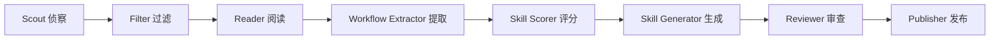

## 概述

**rvaniaaaa** 于 2026 年 7 月 11 日在 X 平台发表了一篇深度文章《How to Build an AI That Never Stops Learning》，提出了一个 **8 阶段自主技能发现流水线**，让 AI Agent 能够**持续从 GitHub 开源仓库中自动发现、提取、转换新的工作流**，并将其打包为标准化的 Agent Skills——全程无需人类干预。

### 核心洞察

> Every AI agent stops improving the moment you stop improving it. Not because the models stop getting better. Because new workflows, architectures and engineering tricks never reach your agent on their own.

**瓶颈不是模型能力，而是知识传递。** 新的工作流、架构模式和工程技巧每天都在 GitHub 上被发布，但它们散落在成千上万个仓库中。发现、评估、整合这些知识，目前仍然依赖人类手动完成。

---

## 8 阶段自主流水线

每个 Agent 只负责一件事，向下一个阶段传递结构化输出：



### ① Scout（侦察兵）

**职责**：持续监控 GitHub Trending 和定向搜索，发现包含新 AI 工作流、Agent 架构、工程模式的仓库。

- 使用 GitHub 高级搜索语法：`stars:>100`、`language:Python`、`archived:false`
- 按更新时间排序，输出结构化候选队列
- 关键词覆盖：agent workflows、MCP servers、agent architectures、engineering patterns

### ② Filter（过滤器）

**职责**：在昂贵的 LLM 调用介入之前，用**确定性规则**剔除明显噪音。

- 排除：游戏项目、CSS 框架、数据集、Starter 模板
- 策略：规则引擎优先于 LLM，节省 token 和计算成本
- 只有通过过滤的仓库才进入下一阶段

### ③ Reader（阅读器）

**职责**：按固定优先级顺序阅读仓库内容，逐步构建上下文。

```
README → docs/ → examples/ → package.json/requirements.txt → 源代码
```

- 优先理解**意图**，再深入**实现细节**
- 只有前一步信息不足时才进入下一步
- 最大化 token 利用效率

### ④ Workflow Extractor（工作流提取器）⭐ 系统核心

**职责**：判断仓库是否包含**可复用工作流**，并将其提取为标准化结构。

提取结构：
```yaml
skill_name: string
goal: string
inputs: list
steps: list (>= 3)
outputs: list
failure_modes: list
```

- 若无可复用内容，仓库直接退出流水线
- 这是整个系统**价值创造的关键节点**

### ⑤ Skill Scorer（技能评分器）

**职责**：用**确定性规则**（非 LLM）评估工作流质量。

评分标准（硬性门槛）：
- README 存在
- 示例代码存在
- 工作流步骤 ≥ 3
- 可复用
- 通用性强
- 置信度 > 0.85

> 设计理由：规则引擎比 LLM 更快、更便宜、更可预测。评分不需要"创造力"，需要"一致性"。

### ⑥ Skill Generator（技能生成器）

**职责**：将通过的 workflow 转换为标准化 Agent Skill 包。

生成的包结构：
```
skill-name/
├── SKILL.md          # 主要指令文件（YAML frontmatter + Markdown body）
├── examples.md       # 使用示例
├── commands.md       # 命令参考
├── metadata.json     # 元数据（版本、作者、依赖）
└── tests.md          # 测试用例
```

- 与 **Anthropic Agent Skills 标准**（2025.12 发布）对齐
- 任何 Agent 可即装即用，无论来源

### ⑦ Reviewer（审查者）

**职责**：独立于生成器，回答一个核心问题：

> "Would an experienced engineer install this Skill without editing it?"

- **生成与审查分离**——写过 Skill 的 Agent 绝不批准自己的作品
- 输出：YES/NO + 推理
- 这是防止"自产自销"式质量衰退的关键设计

### ⑧ Publisher（发布器）

**职责**：纯自动化发布流程。

```
GitHub Action → 创建分支 → 提交 Skill 包 → 打开 PR → 分配审查者
```

- ⚠️ **绝不自动合并**——人类始终掌握最终批准权
- 自动化的是"流程"，不是"决策"

---

## 设计哲学

### 核心原则

> **Automation proposes. Humans approve.**

流水线的设计思想不是"取代人类"，而是"消除瓶颈"。人类不应该浪费时间在"发现有哪些新东西"上——那是机器该做的事。人类应该专注于**判断和决策**。

### 关键架构决策

| 决策 | 理由 |
|------|------|
| 每个 Agent 只做一件事 | 可靠性、可维护性、可调试性 |
| Filter 用规则不用 LLM | 节省成本，确定性更高 |
| Reader 先读文档再读代码 | 大多数仓库在 README 里已经说清了工作流 |
| Scorer 用规则不用 LLM | 评分是客观标准，不需要 AI 判断 |
| 生成与审查分离 | 防止自我批准导致质量退化 |
| 不自动合并 | 人类始终是安全阀 |
| 不重新训练模型 | 扩展的是技能库（工具），不是模型权重 |

---

## 生态系统背景

rvaniaaaa 的文章不是孤立的技术方案，它嵌入在 2025-2026 年 AI Agent 生态系统的几个关键趋势中：

### 1. Agent Skills 标准（Anthropic，2025.12）

- 2025 年 12 月 Anthropic 在 agentskills.io 发布开放标准
- 核心文件 `SKILL.md`：YAML frontmatter（name, description）+ Markdown 指令
- 2026 年 1 月已被 OpenAI Codex、Gemini CLI、GitHub Copilot、VS Code 等 26+ 平台采纳
- 2026 年 3 月公开索引已超 **50 万 Skills**

### 2. Agent Kernel — 自我进化 Agent 的知识底座

**Yaala Labs** 的 Agent Kernel（Apache 2.0）提出了**持久化知识库**模式：

| 层级 | 特性 | 范围 |
|------|------|------|
| Session Memory | 易失 | 单次对话 |
| Knowledge Bases | 持久、跨会话 | 跨会话、跨 Agent、跨部署 |

支持三种后端：
- **ChromaDB**（向量）— 语义相似搜索
- **Neo4j**（图）— 关系推理与多跳查询
- **Starburst Galaxy**（SQL）— 结构化数据分析

核心模式：**Agent 可以把学到的东西写回 KB，下次不同 Agent 遇到同样问题可以直接从 KB 读取**，无需重复推理。

### 3. RAVANA AGI

一个开源的自进化 Agent 系统，核心理念：
- 持续运行时（continuous runtime），不依赖人类持续提示
- 长期记忆（VLTM）与经验积累
- 情感建模与自我反思
- 元认知意识（metacognitive awareness）

### 4. 自主技能发现学术前沿

ACM CAIS 2026 Agent Skills Workshop 上报告的几种方法：

| 方法 | 核心思路 | 效果 |
|------|----------|------|
| SEAgent | 世界状态模型 + 课程生成器 | OSWorld 成功率从 11.3% → 34.5% |
| SAGE | 强化学习中保留早期技能 | 比基线提升 8.9%，tokens 减少 59% |
| CUA-Skill | 人专家知识编码为参数化执行图 | WindowsAgentArena 57.5% SOTA |
| Agentic Proposing | 组合式技能合成 | 30B 模型 AIME 2025 达 91.6% |

---

## 深度分析

### 这篇文章为什么重要

1. **问题定义精准**：AI Agent 的瓶颈不是模型智商，而是"新知无法自动到达 Agent"。这是一个**信息传递**问题，不是**智能不足**问题。

2. **方案务实**：不是空谈 AGI 或自我意识，而是用 8 个窄 AI Agent 完成一条确定性流水线。每个组件都是可理解、可调试、可替换的。

3. **人机边界清晰**：自动化提议，人类批准。这是目前阶段最合理的协作模式——既利用了机器的规模化搜索能力，又保留了人类的判断力。

4. **踩在标准之上**：直接对接 Anthropic 的 Agent Skills 标准，不是自建封闭生态。这确保了产出的 Skills 可以被任何遵循该标准的 Agent 使用。

### 局限与挑战

- **范围受限**：目前只覆盖 GitHub（代码类工作流），无法触达论文、博客、内部文档等其他知识源
- **质量依赖人类审查**：最终的 PR 批准仍然需要人——如果 PR 数量爆炸，会成为新瓶颈
- **技能安全风险**：Snyk 审计发现 13.4% 的社区 Skills 包含严重安全问题（76 个确认恶意 payload）。自主发现的 Skills 如何保证安全？
- **冷冻问题**：Skills 生成后是否更新？GitHub 仓库迭代后，对应 Skill 如何同步？

### 与现有系统的关系

rvaniaaaa 的流水线本质上是在解决 **Agent Skills 的供给侧问题**。当前 Agent Skills 生态的最大瓶颈是"谁来做 Skills"——要么是人手动写，要么是模型生成。这个流水线提出了第三种方案：**从开源世界自动挖掘**。它位于技能生态的"上游"位置。

---

## 关键引用

- 原文：[How to Build an AI That Never Stops Learning](https://x.com/rvaniaaaa/status/2075975822461084061) — rvaniaaaa, 2026-07-11
- 交叉发布：[How to Build an AI Agent That Keeps Learning From GitHub](https://pub.towardsai.net/how-to-build-an-ai-agent-that-keeps-learning-from-github-9549b4be58ee) — Towards AI
- Agent Skills 标准：[agentskills.io](https://agentskills.io)
- Agent Kernel：[yaalalabs/agent-kernel](https://github.com/yaalalabs/agent-kernel)
- 安全审计：Snyk ToxicSkills Audit, 2026
- ACM CAIS 2026 Agent Skills Workshop 论文集

---

## 延伸思考

1. **如果把这个流水线反向应用到 Obsidian Vault 会怎样？** 自动扫描社区插件、工作流模板、Dataview 查询片段，转化为标准化的"Vault Skills"？

2. **多模态扩展**：目前只扫描代码仓库。如果加上 ArXiv 论文解析、博客文章提取、视频教程拆解，流水线需要怎样改造？

3. **信任链问题**：当 Agent 自主发现并安装新 Skills 时，信任的传递链是：GitHub 作者 → 仓库质量 → 提取准确性 → 生成质量 → 审查判断。每一环都有衰减。如何在不过度增加人工审查成本的前提下加固这条链？

4. **技能退化检测**：如果某个 Skill 依赖的 API 变更了，或者底层模型升级后 Skill 变得多余，系统如何自动检测并标记"该 Skill 可能需要重新审查"？

---

原笔记来源：https://x.com/rvaniaaaa/status/2075975822461084061
