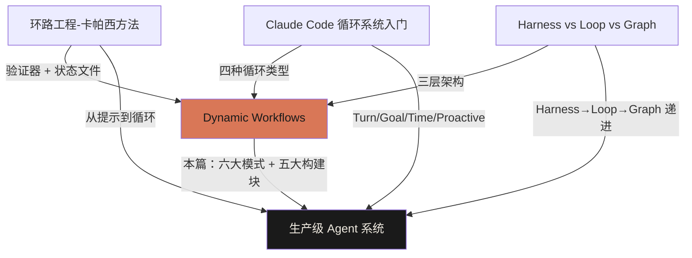

> **一句话总结**：杠杆点从「写出更好的提示」转移到了「设计更好的系统来写提示」。Dynamic Workflows 和 Loop Engineering 是同一个思想的两个表达：过去在你脑中、在提示之间发生的工作，现在可以编码进一个在你做其他事情时持续运行的系统。

---

## 30 秒答案

| 维度 | 旧范式 | 新范式 |
|------|--------|--------|
| **你的角色** | 提示操作员（每步都在） | 系统设计师（定义一次） |
| **AI 角色** | 计算器（你输入，它输出） | 引擎（自发现、自委派、自验证） |
| **核心技能** | 写提示词 | 设计环路 + 定义门控 |
| **关键产出** | 一次性的回答 | 可重复运行的系统 |
| **质量保证** | 你自己读 | 独立验证器 + 硬门控 |

---

## Part 1 · Dynamic Workflows 深度拆解

> Dynamic Workflows 于 2026 年 5 月 28 日在 Claude Code 中发布。触发方式："make a workflow that…" 或使用 `ultracode` 关键词。

### 1.1 为什么默认 Harness 不够

Claude Code 的默认设置是模型在单一上下文窗口中规划和执行。这对典型编码任务足够，但以下工作不适合：

| 工作类型 | 默认 Harness 的失败方式 |
|---------|---------------------|
| 跨数百文件的并行任务 | 上下文窗口装不下，顺序执行太慢 |
| 需要独立验证输出的工作 | 同一個模型审自己的作业 |
| 长时间运行的任务 | 目标在几十轮对话中悄悄漂移 |
| 模型对自己先前工作存在偏见 | 自我偏好偏差无法消除 |

### 1.2 三种结构性失败模式

Dynamic Workflows 在**结构层面**解决了单上下文长时间 Agent 工作中的三个失败模式：

```
┌─────────────────────────────────────────────────┐
│  失败模式                    Workflow 的结构性修复  │
├─────────────────────────────────────────────────┤
│  1. Agentic Laziness        独立 Agent 只被分配   │
│     检查 50 项中的 20 项     明确的任务片，无法      │
│     就报告"已处理"           假装完成了未检查的      │
│                                                       │
│  2. Self-Preferential Bias  工作和验证分别用不同   │
│     自己审自己的作业          的 Agent 实例，验证者   │
│     永远给 A+                看不到制作者的推理      │
│                                                       │
│  3. Goal Drift              每个 Agent 有独立上下   │
│     原始约束在第 47 轮对话    文窗口和聚焦目标，     │
│     中悄悄消失               不累积漂移              │
└─────────────────────────────────────────────────┘
```

### 1.3 核心 API 三元组

```javascript
// 三个函数完成 90% 的 Workflow 工作

// ① agent() — 生成一个子 Agent
agent(prompt, { model?, schema? })

// ② parallel() — 扇出并等待全部返回（屏障）
parallel([() => agent(...), () => agent(...)])

// ③ pipeline() — 流式阶段，每项独立流经每一阶段
pipeline(items, stage1, stage2, stage3)
```

**parallel() vs pipeline() 的决策规则：**

> 问自己：「我需要所有结果才能继续吗？」
> - 是 → `parallel()`（需要全局去重/计数/早期退出）
> - 否 → `pipeline()`（总耗时更短，token 更省）

| 场景 | 选 parallel | 选 pipeline |
|------|-----------|-----------|
| 需要跨所有结果去重 | ✅ | ❌ |
| 每项独立处理，无交叉依赖 | ❌ | ✅ |
| 需要知道「一共找到几个」再决定下一步 | ✅ | ❌ |
| 审查 + 验证（验证不依赖其他审查结果） | ❌ | ✅ |

### 1.4 六大实战模式

#### 模式 1：Classify and Act（分类后路由）

```
输入 → [廉价的分类 Agent] → 分支路由
                              ├→ 简单任务 → Haiku
                              ├→ 中等任务 → Sonnet
                              └→ 复杂任务 → Opus
```

**适用场景**：子任务复杂度差异大，想把 Opus 级算力只用在真正需要的地方。

**关键洞察**：不是所有工作都需要最聪明的模型。先分类，再分配。

---

#### 模式 2：Fan-Out and Synthesize（扇出后合成）

```
工作清单 → parallel([agent₁, agent₂, ..., agentₙ])
                    ↓（所有结果返回后）
              [合成 Agent] → 一份结构化报告
```

**这是最常用的模式。** 适用于任何有明确可枚举列表的工作：50 个文件、200 个端点、100 个支持工单。

```javascript
// 代码示例
const reviews = await parallel(
  files.map(file => () => agent(
    `Review ${file} for security issues`,
    { model: "haiku", schema: IssueList }
  ))
);
const report = await agent(
  `Merge these reviews into one prioritized report`,
  { model: "opus" }
);
```

**关键洞察**：每个子 Agent 只看到自己的切片 —— 零交叉污染。

---

#### 模式 3：Adversarial Verification（对抗验证）

```
[工作 Agent：生成产物]  ──→  产物
[验证 Agent：只看到产物 + 评分标准]  ──→ 通过/驳回
         ↑ 
    看不到制作者是谁，也看不到制作者的推理过程
```

**这是自我偏好偏差的结构性修复。** 验证者只收到工件和评分标准，永远不接触原始工作或制作者推理。自我偏好无法通过 prompt 渗入。

**关键洞察**：不是「让模型更诚实」，而是「让偏见的路径根本不存在」。

---

#### 模式 4：Generate and Filter（生成后筛选）

```
多个 Agent 生成选项 → 筛选层去弱留强 → 去重 → 评分 → 最终 3 个
         ↑                                    ↑
    发散阶段（量大）                        收敛阶段（严格）
```

**关键洞察**：Claude 在**所有选项被挑战之后才做出承诺**，而不是一开始就锁定"感觉对"的选项。要求 20 个产品名，收到的是经过每一层检查后幸存的 3 个。

---

#### 模式 5：Tournament（锦标赛）

```
选手 A ─┐
        ├→ 裁判 ─┐
选手 B ─┘        ├→ 裁判 ─→ 冠军
选手 C ─┐        │
        ├→ 裁判 ─┘
选手 D ─┘
```

**比较性判断比绝对评分更可靠** —— 尤其适用于品味类工作（设计选择、内容排序、候选人筛选）。

**也解决规模问题**：在一个 prompt 中排序 1000 项的可靠性迅速下降；锦标赛将淘汰赛分布到新鲜 Agent 上，每次比较都廉价且隔离。

---

#### 模式 6：Loop Until Done（循环至完成）

```
while (stop_condition_not_met) {
  spawn_agent();
  check_result();
}
```

适用于剩余工作量未知的任务：没有新 bug 发现 → 停止；所有测试通过 → 停止；一个理论被确认 → 停止。

**配合 `/goal` 设定硬性完成条件。** 循环括号活在确定性代码中；只有活跃迭代留在上下文中。

---

### 1.5 生产环境中的模式组合

模式很少单独出现。真实生产 Workflow 通常组合 2-4 个：

| 用例 | 模式组合 |
|------|---------|
| 迁移 / 重构 | Fan-out → Adversarial Verification → Loop Until Done |
| 深度研究 | Fan-out（并行搜索）→ Adversarial Verification（逐条验证）→ Synthesize |
| 排序 1000+ 项 | Tournament（配对淘汰） |
| 根因调查 | Generate Theories → Panel of Verifiers → Loop Until One Survives |
| 大规模 Triaging | Classify-and-Act → Dedupe → Fix or Escalate → Loop |
| 设计 / 命名选择 | Generate-and-Filter → Tournament with Rubric |

**选择模式的捷径：识别任务属于哪种失败模式。**

```
漂移（Drift）         → Fan-out
自我偏好（Self-pref）  → Adversarial Verification
开放范围（Open-ended） → Loop Until Done
难评分（Hard to score）→ Tournament
```

### 1.6 成本控制三控

| 控件 | 作用 | 不用会怎样 |
|------|------|-----------|
| `/goal` | 硬性完成条件 | Workflow 在软完成点停下，实际未完成 |
| `/loop` | 定期重复调度整个 Workflow | 适合 triage、周度研究更新、持续验证 |
| Token 预算声明 | 硬上限 | 雄心勃勃的 Workflow 可能膨胀到预期的 5-10 倍 |

---

### 1.7 隔离模式（Quarantine Pattern）

任何读取非你撰写内容的 Workflow —— 支持工单、抓取页面、用户反馈、第三方 API 响应 —— 都应将其视为潜在的 prompt injection 向量。

```
[只读 Agent：读取不可信内容]  ──→  提取的结构化数据
     ↑ 无写入权限                    ↓
     ↑ 不能执行高权限操作      [执行 Agent：零接触原始输入]
                                   ↑ 有写入权限
```

**30 行只读 reader 几乎不花费任何成本，但消除了一整类风险。**

### 1.8 将 Workflow 保存为 Skill

1. Workflow 跑通后，按 `s` 保存
2. 保存到 `~/.claude/workflows`
3. 可本地复用，或打包进 Skill 文件夹（含 `SKILL.md`）分享

**关键细节**：打包为 Skill 时，prompt Claude 将其视为**模板**而非逐字执行的脚本 —— 形状不变，细节适配具体任务。

---

## Part 2 · Loop Engineering 深度拆解

> Loop Engineering = 用系统替代你作为「提示者」的实践。你建造一个小系统，它自己发现工作、交给 Agent、检查结果、记录发生了什么、决定下一步 —— 按计划自主运行，无需你在每个周期输入。

### 2.1 四条件前置测试

**在建造任何循环之前，跑这个测试。** 错过一个条件，循环的成本就超过回报。

```
┌──────────────────────────────────────────────────┐
│  条件 1: 任务重复                                │
│  工作至少每周重复出现。否则设置成本永远无法摊销。  │
│  你只是为一次运行写了个脚本。                     │
├──────────────────────────────────────────────────┤
│  条件 2: 验证自动化                              │
│  需要一个能在你不在场时使工作失败的机制：测试套件、 │
│  类型检查器、linter、构建。没有自动门控 = 你回到   │
│  手动阅读每个 diff 的状态。                       │
├──────────────────────────────────────────────────┤
│  条件 3: Token 预算能吸收浪费                     │
│  循环重读上下文、重试、探索支线路径。无论是否交付   │
│  成果，这些 token 都烧掉了。这种技术随预算扩展。    │
├──────────────────────────────────────────────────┤
│  条件 4: Agent 有正确的工具                       │
│  日志、可复现环境、运行自己所写内容并观察什么坏了   │
│  的能力。没有这些，循环在黑暗中迭代。              │
└──────────────────────────────────────────────────┘
```

**诚实版**：Loop Engineering 是真实的，但大多数开发者还不需要它。对于一次性任务、探索性工作、或任何"完成"是判断性决策的工作，**一个精准的 prompt 仍然胜出。**

---

### 2.2 五大构建块

#### ① Automations（自动化 —— 心跳）

自动化是让循环成为真正循环的东西。它们在计划、事件或触发条件上触发。

| Claude Code 原语 | 用途 |
|------------------|------|
| `/loop` | Session 范围内的定期重运行 |
| Desktop scheduled tasks | 重启后仍存活 |
| Routines | 笔记本关闭时云端运行 |

**两个关键原语分离**：`/loop` 定期重运行；`/goal` 持续运行直到你定义的条件被独立 checker 模型验证。

---

#### ② Worktrees（工作树 —— 并行无冲突）

运行多个 Agent 意味着文件冲突，除非你隔离它们。

> Git worktree 给每个 Agent 自己的工作目录和分支，共享仓库历史但不共享其他任何东西。一个 Agent 的编辑从物理上无法触及另一个 Agent 的 checkout。

Claude Code 通过 `--worktree` 标志和子 Agent 上的 `isolation: worktree` 设置直接暴露此能力。

---

#### ③ Skills（技能 —— 写一次上下文，每次运行都读）

> 一个 Skill 是一个包含 `SKILL.md` 的文件夹 —— 项目约定、构建步骤、"因为那次事故永远不要碰这个文件"的知识。写一次，每个循环周期都读。

| 没有 Skills | 有 Skills |
|------------|----------|
| 循环每次从零重新推导整个项目上下文 | 意图随运行次数复合增长 |
| Token 浪费在重复发现上 | Token 花在实际工作上 |

---

#### ④ Connectors / MCP（连接器 —— 循环触碰真实工具）

一个只能看见文件系统的循环是一个小循环。MCP 连接器让 Agent 读取 issue tracker、查询数据库、命中 staging API、发送 Slack 消息。

**这是「这是修复方案」的 Agent 和「开了 PR、关联了 Linear 工单、CI 绿了之后 ping 了频道」的循环之间的区别。**

按价值排序的连接器：
1. **GitHub** —— PR、Issues、Actions
2. **Linear / Jira** —— 工单状态与关联
3. **Slack** —— 通知与人工介入
4. **Sentry** —— 错误追踪与回归检测

---

#### ⑤ Sub-agents（子 Agent —— 制作者远离检查者）

> 写了代码的 Agent 距离公正评分太近。一个指令不同、有时模型也不同的第二个 Agent 能捕获第一个 Agent 合理化了的问题。

```
[探索 Agent] → [实现 Agent] → [验证 Agent（对照 spec）]
                                      ↑
                         验证者是你能走开而循环在运行的唯一原因
```

---

### 2.3 状态文件：Agent 会忘记，仓库不会

> Agent 默认拥有短记忆。今天学会的东西明天就没了，除非写进某个持久化位置。

```
状态文件 = 每个工作循环的脊柱
可以是：Markdown 文件、Linear Board、JSON blob
记录：什么完成了、什么是下一步
明天的运行 = 恢复（resume），不是重启（restart）
```

**对于有漂移风险的长时间循环**：将状态文件与一个常设 spec 配对 —— `VISION.md` 或 `AGENTS.md` —— Agent 每次运行都重读。

```
状态告诉 Agent 它在哪。
Spec 告诉 Agent 去哪。
```

---

### 2.4 最小可行循环（Minimum Viable Loop）

在加入子 Agent、连接器或多阶段验证之前，先建造**最小能工作的东西**：

```
① 一个自动化     — 带明确停止条件的定时运行
② 一个 Skill     — Agent 否则会从零重新推导的项目上下文
③ 一个状态文件   — 什么完成了、什么是下一步、学到了什么
④ 一个门控       — 能使坏工作自动失败的测试/构建/类型检查
```

**顺序**：先让一次手动运行可靠 → 变成 Skill → 包进循环 → 然后调度。跳过前面步骤就是循环在生产中失败的方式。

---

### 2.5 真正重要的指标

> **每次接受变更的成本。** 不是花了多少 token，不是尝试了多少任务。
>
> 如果接受变更率低于 50%，循环正在以比你移除它更快的速度生成审查工作。

---

### 2.6 悄悄烧钱的失败模式

| 失败模式 | 症状 | 修复 |
|---------|------|------|
| **Ralph Wiggum 循环** | Agent 提前发出完成信号，循环在半成品上退出 | 硬门控——在确定性标准上 pass/fail，不是意见 |
| **Goal Drift（目标漂移）** | 约束随长会话消失（上下文压缩是有损的） | 每次运行重读 `VISION.md` |
| **Self-Preferential Bias** | 制作者给自己的作业评分 | 独立验证器子 Agent，零接触制作者推理 |
| **Agentic Laziness** | 循环在部分完成时声明"够好了" | `/goal` + 目标停止条件由新鲜模型检查 |

---

### 2.7 循环变得越好就越严重的两个风险

```
┌─────────────────────────────────────────────────┐
│  风险 1: Comprehension Debt（理解债务）           │
│                                                  │
│  循环交付代码越快，代码库内容和你的理解之间的差距  │
│  就越大。昂贵的账单不是 token 账单。              │
│  是你必须调试一个团队中没有人真正读过的系统的那天。│
│                                                  │
│  缓解: 读 diff、偶尔抽查门控、不让循环碰架构和     │
│        判断性工作、和队友 pair-design 循环        │
├─────────────────────────────────────────────────┤
│  风险 2: Cognitive Surrender（认知投降）          │
│                                                  │
│  停止形成自己的判断、接受循环返回的任何东西的拉力。│
│  带着判断设计循环 = 解药。                         │
│  为了逃避思考而设计循环 = 加速器。                 │
│  同一个行为，相反的结果。                         │
└─────────────────────────────────────────────────┘
```

---

### 2.8 安全：无人值守的循环 = 无人值守的攻击面

| 攻击向量 | 缓解措施 |
|---------|---------|
| 生成代码未经审查就合并 | SAST + 依赖审计 + 密钥扫描在门控中 |
| Skills 可携带 prompt injection | 安装前审计 skill 源码（一次对 17,000+ 社区 skill 的审计中发现 520 个泄露了凭证） |
| 调试日志散落密钥 | 生产循环中禁用 verbose logging |
| 权限范围 creep | 每 30 天重新审计循环权限 |

---

## 两篇文章共同确认的错误清单

| # | 错误 | 后果 |
|---|------|------|
| 1 | 一个常规 session 五分钟就能完成的工作，却用 Workflow 或循环 | 杀鸡用牛刀 |
| 2 | 没有 token 预算 | 雄心勃勃的运行膨胀到预期的 5-10 倍 |
| 3 | 一个 Agent 既做工作又做验证 | 自我偏好永远给 A+ |
| 4 | 没有状态文件 | 明天的运行从零开始 |
| 5 | 软停止条件 | "看起来好就行"不是停止条件 |
| 6 | 把 `parallel()` 和 `pipeline()` 当可互换 | 屏障（barrier）的代价很大 |
| 7 | 循环模式中跳过 `/goal` | Workflow 在第一个软完成点退出 |
| 8 | 在消费级计划上运行重度验证循环 | 烧钱且触达 API 限制 |
| 9 | 不读源码就自动安装社区 skill | prompt injection 风险 |
| 10 | 不读 diff | 理解债务复利增长 |

---

## 与你的知识库的关联



| 已有笔记 | 提供什么 | 本篇补充什么 |
|---------|---------|------------|
| [环路工程-卡帕西方法](/posts/obsidian/karpathy-loop/) | 循环三要素（验证器/状态/prompt）、卡帕西工作流 | 六大可组合的 Workflow 模式、四条件前置测试、五大构建块 |
| [Claude Code 循环系统入门](/posts/obsidian/claude-code-loops/) | 四种循环类型（Turn/Goal/Time/Proactive） | 模式组合方法、成本控制三控、安全隔离模式 |
| [Harness vs Loop vs Graph Engineering - 三层架构深度研究](/posts/obsidian/harness-loop-graph/) | Harness → Loop → Graph 递进架构 | Loop 层的具体工程实践、失败模式分类、MCP 连接器优先级 |
| [Harness工程学习总结](/posts/obsidian/harness-engineering/) | Harness 基础概念 | Workflow 级别的 harness 设计（动态生成、JavaScript 脚本化） |

---

## 个人行动清单

读完这篇文章后，可以立刻做的事：

- [ ] **第一步**：把下一次"跨多个文件做同一件事"的常规 session，尝试用 `"make a workflow that…"` 触发 Dynamic Workflow
- [ ] **第二步**：为一个重复性任务建立最小可行循环 —— 一个 Skill + 一个状态文件 + 一个自动门控
- [ ] **第三步**：检查当前是否有"一个 Agent 既做工作又审工作"的模式 —— 拆成两个，验证者不接触制作者推理
- [ ] **第四步**：给每个循环加 token 预算声明，避免意外膨胀
- [ ] **第五步**：每 30 天审计一次循环权限，检查是否有 scope creep

---

> **最后一句，也是最有力的一句**：
>
> 杠杆点从「写出更好的提示」转移到了「设计更好的系统来写提示」。
> Dynamic Workflows 和 Loop Engineering 是同一个思想的两种表达
> ——过去在你脑中、在提示之间发生的工作，现在可以编码进一个在你做其他事情时持续运行的系统。
>
> **建造最小的能工作的版本。交付它。然后扩展。**
